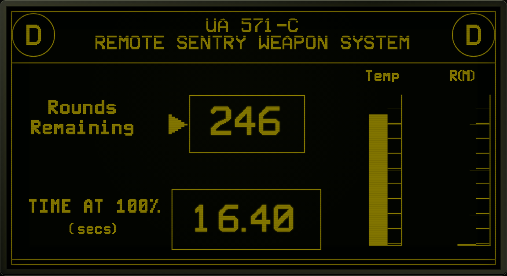

# UA571C.com

[](https://github.com/banastas/UA571C.com/actions/workflows/ci.yml)
[](#local-development)

A keyboard-controlled working-prop study of the UA 571-C remote sentry terminal from [*Aliens*](https://onesheet.org/movie/aliens-1986/).

**[Launch the terminal at UA571C.com](https://ua571c.com/)**

[](https://ua571c.com/)

UA571C.com opens directly into the fictional remote terminal, without a separate landing page, navigation, feature grid, or gallery. The visitor configures the system, runs its test routine, arms it, and fires up to 500 simulated rounds.

The interface is rebuilt in HTML, CSS, and JavaScript from visual references. It ships no film stills, video, recorded audio, framework, or third-party runtime library. Terminal audio is synthesized locally with the Web Audio API after user input.

## Controls

| Key | Action |
| --- | --- |
| `1` through `7` | Cycle the corresponding selector |
| `Space` | Arm and hold to fire |
| `E` | Arm and toggle automatic engagement |
| `T` | Run the selected test routine |
| `R` | Reload and cool the system |
| `M` | Toggle synthesized terminal sound |
| `F` | Toggle fullscreen |
| `V` | Switch between configuration and live telemetry |
| `?` | Show the command overlay |
| `Esc` | Cease fire or close the current overlay |

Every selector and command also has a pointer and touch path. The boot sequence completes automatically. Press `Escape`, activate the skip button, or click the boot surface to enter the terminal immediately.

Phones and tablets operate in landscape. Installed and fullscreen modes request a landscape display. Portrait browser sessions show a focused rotation interlock and safely cease active or automatic fire until the device returns to landscape. Reduced-motion preferences skip the animated boot sequence.

## Original GRiD fonts

The terminal self-hosts browser conversions of the original 1984 GRiD bitmap font binaries preserved by [Thom Cherryhomes](https://github.com/tschak909), whose [UA571C reconstruction](https://github.com/tschak909/UA571C) includes the recovered GRiD development environment and Pascal source.

The recovered source maps TypeBlock 12×16 to headers and numeric readouts, TypeBlock 24×32 to unit roundels, TypeBlock 9×12 to fields and telemetry labels, and TypeGRiD 5×8 to system text. This responsive browser version uses the original 24×32 companion face for headers and counters because its strokes remain legible at display sizes where the packed 12×16 face becomes ambiguous.

The original `.TYP` objects, deterministic WOFF2 conversions, attribution, and reproducible converter are documented in [`assets/fonts`](assets/fonts/README.md). Generated font filenames contain a content digest because production serves them with an immutable cache lifetime.

## Local development

The site is build-free and has no runtime dependencies. Node.js 20 or newer is required for the development and browser-test tooling.

```sh
npm ci
npm start
```

Open <http://localhost:4173>.

## Verification

Run the fast state, analytics, font, structure, metadata, deployment, and accessibility checks:

```sh
npm run check
```

Install Chromium once, then run the complete browser suite:

```sh
npx playwright install chromium
npm run check:all
```

The browser suite exercises desktop and mobile boot behavior, controls, state transitions, film-matched timing, critical warnings, responsive bounds, accessibility names, orientation safety, analytics privacy, the 404 route, and console errors. CI runs both layers on every push to `main` and every pull request.

### Refreshing the social preview

The README image and Open Graph card are the same deterministic 1152×627 capture. Regenerate it from the current local source with:

```sh
npm run capture:preview
```

The capture reproduces the film-reference telemetry moment at 246 rounds remaining. Structural validation checks the PNG type and dimensions against the page metadata so the social card cannot silently drift.

## Analytics and privacy

Google Analytics 4 measures the production terminal journey, including boot completion, selector changes, diagnostics, view changes, firing sessions, reloads, automatic engagement, sound, fullscreen, help use, faults, and the orientation interlock.

Analytics is gated to the production hostname, strips URL queries and fragments, disables Google Signals and ad-personalization signals, and never emits per-round events. Local development and hosting previews remain silent. The complete event contract, custom-definition map, privacy boundary, and live verification procedure are in [`docs/ANALYTICS.md`](docs/ANALYTICS.md).

## Deployment

The repository root is the deployable static artifact. No build command is required.

| Setting | Value |
| --- | --- |
| Publish directory | `/` |
| Build command | None |
| Canonical domain | `https://ua571c.com/` |
| Not-found page | `404.html` |

`CNAME` supports GitHub Pages. `_headers` provides compatible security and cache headers on Cloudflare Pages and Netlify. `.nojekyll` prevents GitHub Pages from applying Jekyll processing. DNS and hosting configuration remain external to this repository.

## Project structure

```text
index.html                       Terminal markup, metadata, and structured data
styles.css                       Responsive terminal, CRT, and interaction styling
404.html                         Branded not-found page
preview.png                      README and social-card capture
assets/fonts/                    Original GRiD objects and browser conversions
src/app.mjs                      DOM, input, audio, animation, and orientation behavior
src/state.mjs                    Pure terminal state machine
src/analytics.mjs                Production-gated GA4 runtime and event contract
src/analytics-page.mjs           Canonical analytics entry point for the 404 page
tests/*.test.mjs                 Node state, font, and analytics tests
tests/browser.spec.mjs           Desktop and mobile Playwright suite
scripts/validate.mjs             Structural and deployment validation
scripts/build-fonts.py           Reproducible GRiD .TYP to WOFF2 converter
playwright.config.mjs            Local and CI browser-test configuration
docs/CONCEPT.md                  Product and experience rationale
docs/ANALYTICS.md                Analytics event and privacy contract
.github/workflows/ci.yml         Continuous integration
```

## Design boundaries

- The interface is the product demonstration and the entire product site.
- The crude grid, yellow phosphor, hard selection bars, and finite ammunition state are the identity.
- Explanatory material stays outside the live terminal so the working-prop illusion survives.
- The project is a fan-made interface study, not an official product or a simulation of a real weapon system.
- Motion preferences are respected, and every interaction has keyboard and pointer paths.

The current telemetry layout follows the clearest full-screen film reference, including its `D` roundels. `UA 571-C` is the fictional weapon model, while the roundel letter identifies the active sentry unit. See [the concept note](docs/CONCEPT.md) for the complete rationale.

## Acknowledgment

Inspired by the fictional UA 571-C remote sentry terminal seen in *Aliens* (1986). *Aliens* and associated names and designs belong to their respective rights holders. This non-commercial fan project is presented as an interface study and tribute.
